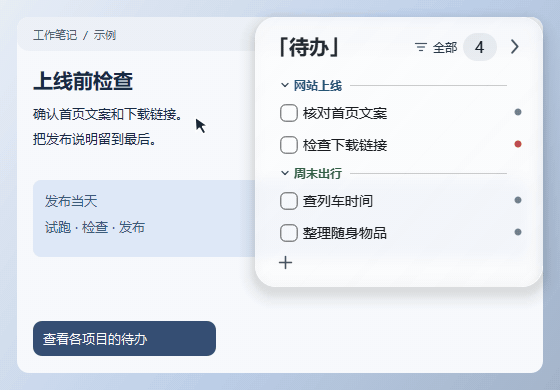

# 待办面板

一个固定在 Windows 屏幕右上角的待办浮窗。任务可按项目分组，浮窗可收成屏幕边缘的小把手。



[MP4](assets/demo.mp4)

## 怎么用

- 点底部的 `+` 添加待办，按回车保存。
- 点顶部切换项目，点任务右侧的色点改紧急程度。
- 点右上角的箭头收起，点屏幕边缘的把手展开。
- 右键空白处可选显示器、切换深浅色和调整透明度。

任务和设置保存在本机的 `%APPDATA%\TodolistPanel\TodolistPanel.ini`。

## 从源码运行

需要 Windows、Qt 6.5 或更新版本，以及配套的 C++ 编译器、CMake 和 Ninja。可以在 Qt Creator 中打开 `CMakeLists.txt`，选桌面套件构建。

也可以在 PowerShell 中构建。下面以 Qt 6.9.3 和 MinGW 13.1 为例，把路径换成自己的安装位置。

```powershell
cmake -S . -B build -G Ninja -DCMAKE_BUILD_TYPE=Release -DCMAKE_PREFIX_PATH=C:/Qt/6.9.3/mingw_64 -DCMAKE_CXX_COMPILER=C:/Qt/Tools/mingw1310_64/bin/g++.exe
cmake --build build --parallel
cmake --install build --prefix (Join-Path $PWD dist)
```

构建后运行 `dist\bin\TodolistPanel.exe`。

## 许可证

项目源码采用 [MIT 许可证](LICENSE)。Qt 和其他第三方依赖各自适用其许可证。
